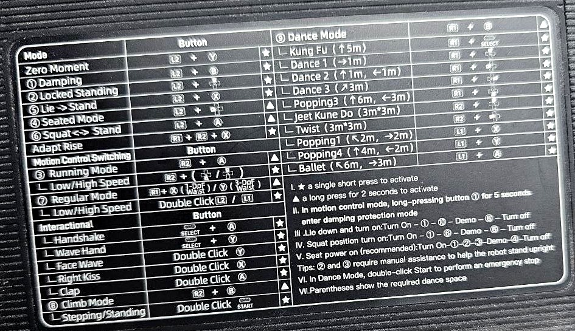
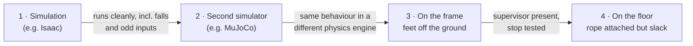

# Unitree G1 Safety Guide

A practical guide for anyone working with the lab's Unitree G1 EDU humanoid for the first time. Read all of it before your first session. Then use the [inspection checklist](inspection-checklist.md) every time the robot is powered on. The hazards and how we control them are in the [risk assessment](risk-assessment.md).

Sources are marked in brackets:
- **(p.N):** a page of the official [Unitree G1 User Manual V1.1](https://reliablerobotics.ai/wp-content/uploads/2025/03/G1-User-Manual_compressed.pdf).
- **(label):** the button guide on the back of our remote ([photo below](#3-the-remote-controller)).
- **(MBS):** the [MYBOTSHOP copy of the manual](https://www.docs.mybotshop.de/downloads/G1_User_Manual.pdf).
- **(Unitree docs):** Unitree's G1 developer documentation (support.unitree.com).

> **Button combinations change between firmware versions.** Older manuals, including the official V1.1 PDF, show different buttons from our remote. Always follow the label on the back of our remote, which matches the robot's firmware. This guide uses only the combinations on that label.

## Read this first

1. **Never alone.** The robot is only powered on with two trained people present: an operator holding the remote and a spotter.
2. **L2 + B is the stop.** The G1 has no physical emergency button. L2 + B puts the robot into damping in every mode. Test it at the start of every session while the robot hangs.
3. **Start and stop on the frame, or seated on a chair with someone holding the robot.** A standing robot that loses power or goes into damping falls to the ground.
4. **Stay 2 m away, and never catch a falling robot.** It weighs about 35 kg and its joints can crush fingers.
5. **Ask before you try anything new.** Any mode or program not described here needs the supervisor's approval first.

## Contents

1. [Roles](#1-roles)
2. [Know the robot](#2-know-the-robot)
3. [The remote controller](#3-the-remote-controller)
4. [Safe operating area](#4-safe-operating-area)
5. [Startup and shutdown](#5-startup-and-shutdown)
6. [Movement limits and prohibited actions](#6-movement-limits-and-prohibited-actions)
7. [Emergencies](#7-emergencies)
8. [Battery, charging and handling](#8-battery-charging-and-handling)
9. [Testing your own code](#9-testing-your-own-code)
10. [Open questions and sources](#10-open-questions-and-sources)

## 1. Roles

| Role | Who | Responsibilities |
|---|---|---|
| Operator | A trained intern | Holds the remote for the whole session and never puts it down while the robot is on. Runs the procedures and gives the stop. |
| Spotter | A second trained person | Keeps the area clear, watches the robot and the room, calls "STOP" when anything looks wrong, and handles the hanging rope. In a seated start, holds the robot while it stands up. |
| Supervisor | Lab staff or mentor | Approves sessions on hardware and any new program before it runs on the robot. Keeps this guide up to date. |

Who may operate the G1:
- Only people aged 18 or over who have read this guide and attended the safety briefing. The G1 is not a toy (p.3).
- Before your first power-on, you must know the modes in [section 3](#3-the-remote-controller) and the stop (p.12).
- Never operate while tired, unwell, or unsure how a step works (p.12). Ask first.

## 2. Know the robot

| Fact | Value | Why it matters |
|---|---|---|
| Size and weight | 1320 mm tall, about 35 kg with battery (p.6) | A falling robot can injure feet and legs. Lifting it takes two people |
| Top speed | Up to 2 m/s (p.25) | Faster than a brisk walk. Keep it away from people |
| Joint torque | Up to 120 N·m at the largest motor (MBS) | Enough to crush fingers. Never touch a moving robot (p.4, p.25) |
| Battery | 13-cell lithium pack, about 2 h of running (p.6, p.25) | Fire risk when damaged or charged wrongly. A flat battery makes the robot fall (p.4) |
| Emergency stop | L2 + B (damping), in every mode (label; Unitree docs) | There is no physical stop button, so the remote is the safety system |
| Losing power | Shut down or out of battery while standing, it "will fall flat on the ground" (p.25) | Shut down only while hanging or seated (p.22) |
| After a fall | The motors switch to a braking state by themselves (p.24) | Wait until it is completely still before going near it |
| Version | EDU: has Develop mode and a development computer (PC2) for your own code (p.21) | Your code never runs on the motion-control computer (MBS) |
| Sensors | LIVOX MID-360 LiDAR and D435i depth camera in the head (p.8) | Keep both clean and uncovered |

## 3. The remote controller

The back of our remote lists every mode and its buttons:

How to read the label (label, note I):
- **★** means a single short press.
- **▲** means a long press: hold the buttons for 2 seconds.
- For a combination, hold the first button and press the second.

Turn the remote on with a short press of its power button, then a long press of more than 2 seconds until it beeps. The right **DL** light comes on when it is connected to the robot (p.20).

### Commands for your first sessions

These are the commands the mentors use when the robot is first powered on, in the order you meet them. The circled numbers are the ones printed on the label.

| Command | Buttons | Press | What the robot does | When to use it |
|---|---|---|---|---|
| **Zero torque** ("Zero Moment" on the label) | L2 + Y | ★ short | All motors are off. The joints go limp and give no resistance. The robot cannot hold itself up (p.13; Unitree docs) | The robot is already in zero torque when it finishes booting, so you don't press anything at the start. Press it only while the robot hangs, for example before packing it. **Never on a standing robot:** it drops at once |
| **① Damping** | L2 + B | ★ short | The motors stop moving the robot but resist movement, like brakes (Unitree docs). A robot standing on its own sinks to the ground | The first command after every power-on. **The emergency stop in every mode.** The last command before every power-off |
| **② Locked standing** | L2 + ↑ | ★ short | The robot moves into a standing posture within about 5 seconds and holds it stiffly. **It does not balance** (Unitree docs) | After damping, to straighten the robot: on the frame before you lower it, or from the chair while someone holds it. Never let go of a robot in locked standing |
| **③ Running mode** | R2 + A | ▲ hold 2 s | Turns on Unitree's locomotion policy. The robot balances itself and can be driven with the sticks, up to running speed. Low/high speed: R2 + ↓ / R2 + ↑ (★) | Once the feet are flat on the ground (hanging start), or while someone holds the robot (seated start). Always start in low speed |
| **⑦ Regular mode** | R1 + X (1-DoF waist) or R1 + Y (3-DoF waist) | ▲ hold 2 s | Unitree's standard walking controller. Low/high speed: double-click L2 / L1 (★) | The alternative to running mode for normal walking at walking pace. Use the button that matches our robot's waist ([section 10](#10-open-questions-and-sources)) |
| **④ Seated mode** | L2 + ← | ▲ hold 2 s | The robot slowly sits down, within about 5 seconds. Balance control is off while it does (Unitree docs) | To end a seated session: the robot stands still with a sturdy chair right behind it, and someone holds its shoulders |

Two more notes from the label:
- **Damping protection:** in running or regular mode, holding L2 + B for 5 seconds puts the robot into "damping protection mode" (label, note II). We haven't tested this yet. In an emergency, use the normal short press of L2 + B.
- **Dance mode:** double-clicking START is the emergency stop (label, note VI).

### Other commands on the label

These need the supervisor's approval. Most need more free space than our lab has.

| Command | Buttons | Press | Notes |
|---|---|---|---|
| ⑤ Lie → stand | L2 + X | ★ | The robot gets up from lying on the floor by itself. Flat, hard floor only; keep well clear (Unitree docs) |
| ⑥ Squat ↔ stand | L2 + A | ▲ | Switches between squatting and standing |
| Adapt rise | R1 + R2 + X | ★ | Not yet explained by the mentors |
| ⑧ Climb mode | R2 + B | ▲ | Unitree advises against stair climbing with the current walking mode (Unitree docs) |
| Stepping / standing (climb mode) | Double-click START | ★ | Switches between stepping in place and standing still |
| Interaction gestures | SELECT + A / SELECT + Y, or double-click Y / X / A | ★ | Handshake, wave hand, face wave, kiss, clap |
| ⑨ Dance mode | R1, R2 or L1 combinations | ★ / ▲ | Each dance needs 1–6 m of free space (shown in brackets on the label). Not allowed in our lab |

## 4. Safe operating area

Run the G1 indoors, inside a marked and cleared zone on a flat, hard, dry floor, at least 2 m from obstacles and people (p.11).

- **Climate:** 0–40 °C, indoors only. The robot is not waterproof or dustproof (p.11).
- **Floor:** flat and clear. No wet, icy, soft or gravel floors. On smooth tiles, walk slowly (p.11). Stairs and slopes need the supervisor's approval.
- **Distance:** at least 2 m between the robot and obstacles or people. The operator keeps the robot in sight at all times (p.3, p.11).
- **Our lab:** the floor is flat, non-slippery tile, but there is no free 4 × 4 m area (desks, chairs, shelves, 3D printers and a screen board). So **no walking in the lab.** In the lab, the robot stays on the frame or seated. Walking needs a larger approved space, taped at least 4 × 4 m with nothing breakable inside.
- **Protective frame:** lock its wheels before every session (p.12). Use the frame for starts, shutdowns and anything new.
- **Radio:** if the remote connection is unstable, switch off other Wi-Fi sources nearby (p.11).
- **Cables:** route Ethernet and power cables where the legs can't catch them, and tape them down outside the zone.
- **Fire:** two powder extinguishers, suitable for electrical fires, are just outside the lab, and a water extinguisher is in the corridor. **Never use water on equipment that is still plugged in.**

## 5. Startup and shutdown

Start and stop the robot only while it **hangs from the frame** or **sits on a sturdy chair** (p.22). If it loses power or goes into damping while standing on its own, it falls (p.25).

### Before every start

1. Complete the "before power-on" part of the [inspection checklist](inspection-checklist.md).
2. **Insert the battery:** slide it in from the side, with its power switch facing the robot's back. Never force it. It is in when it clicks and the buckle is in place (p.12, p.14).
3. **Turn on the remote** and keep it in your hand from now on.

**Power-on:** short-press the battery button once, then press and hold it for more than 2 seconds. Booting takes about a minute. It has finished when all joints are in zero torque, which means limp (p.13, p.16). If you don't hear the ankles hit their limits within 2 minutes while the robot hangs, start-up has failed: power off and check again (p.24).

### A. Hanging start (the default, and the only start used in our lab)

1. **Hang the robot.** With the robot steady on the ground, thread the rope through both shoulder buckles, tie a dead knot, and hook it to the frame. Raise the robot until its feet are off the ground, and arrange the arms and legs naturally (p.14–17).
2. **Power on** and wait for **zero torque**.
3. **L2 + B: damping.** This is also your stop test for the session.
4. **L2 + ↑: locked standing.** The legs straighten into a standing posture. The robot is stiff but not balancing.
5. **Lower the robot** slowly until both feet are flat on the ground and it stands upright on its own feet. The rope stays hooked and slightly slack, ready to catch it.
6. **R2 + A, held for 2 s: running mode.** The robot now balances itself. For regular mode instead, hold R1 + X or R1 + Y for 2 s ([section 3](#3-the-remote-controller)).
7. Check that it stands steadily. Only in an approved walking space, and only once it is stable, does the spotter release the hook. **In our lab, it stays on the rope.**

### B. Seated start (the label's "recommended" start; needs an approved space)

The label's sequence is: turn on, ① damping, ② locked standing, ③ running mode, session, ④ seated mode, turn off. Steps ② and ③ need a person to help the robot stand upright (label, note V).

1. Seat the robot on a sturdy chair without wheels, with its arms and legs placed naturally (p.12–13).
2. **Power on** and wait for **zero torque**.
3. **L2 + B: damping.**
4. **L2 + ↑: locked standing.** One person stands behind the robot and holds it by the back of the shoulders while it stands up. Never hold it by the hips or knees.
5. **R2 + A, held for 2 s: running mode.** Keep holding until the robot balances on its own, then let go and step back.

### Shutdown

- **From hanging (p.22):** bring the standing robot under the frame, hook the rope, and pull it taut so the frame carries the weight. Press **L2 + B** (damping): the robot now hangs instead of sinking. Then turn the battery off with a short press, then a press and hold for more than 2 seconds.
- **From seated:** with the robot standing still and the chair right behind it, one person holds the back of its shoulders. Hold **L2 + ←** for 2 s: the robot sits down. Then press **L2 + B** and turn the battery off.
- **Never** press damping, zero torque or power-off on a robot that is standing on its own: it falls (p.22, p.25).

**After shutdown:** turn off the remote. Arrange the arm and foot joints for the next start. If the robot won't be used for a while, remove the battery by pressing its clip with both hands (p.22).

**Long breaks:** hang the robot and put it in damping, so it can't fall if the battery runs low (p.25).

## 6. Movement limits and prohibited actions

**Movement limits**
- Start every session in low speed and keep to walking pace (p.25).
- On smooth tiles, slopes or uneven ground, slow down and avoid sudden moves (p.11, p.25).
- Keep the robot at least 1 m from the edge of the zone. If it gets close, stop and bring it back to the centre.
- No running and no continuous stepping without the supervisor's approval. The distributor manual marks continuous stepping "not recommended" (MBS).
- Arm payload stays below about 2 kg per arm (3 kg on the EDU), and less with the arm stretched out (MBS).

**Never**
- Touch the robot while it moves or is being carried, or hold it by a joint such as the knees or hips (p.4, p.25). The one exception: holding the back of its shoulders during a seated start or sit-down.
- Let go of a robot in locked standing, or press zero torque (L2 + Y) on a standing robot.
- Operate outdoors or on wet, icy, soft, gravel or dusty ground (p.11), or with the robot out of the operator's sight (p.3, p.11).
- Shut down a standing robot that is not hanging or seated (p.22, p.25).
- Use non-original parts, modify the robot, or recalibrate the joints without asking Unitree support (p.11, p.24).
- Run your own code on the motion-control computer, or send SDK and remote commands at the same time (p.3; MBS).
- Leave a powered robot unattended, or put the remote down while the robot is on.
- Let anyone under 18 operate it (p.3).

## 7. Emergencies

**When in doubt, stop.** Anyone may shout "STOP". The operator immediately presses **L2 + B**. Everyone steps back and waits until the robot is completely still. **Never try to catch a falling robot.**

| Situation | Do immediately | Then |
|---|---|---|
| Loses balance or starts to fall | Shout "STOP", press L2 + B, step back | Wait until it is still (its motors brake after a fall, p.24). Power off and do the after-a-fall checks in the [checklist](inspection-checklist.md) |
| Unexpected or jerky movement | L2 + B. If your program is running, stop it too (Ctrl+C) | Don't restart until you know the cause. Jitter from your own code often means Develop mode wasn't on (p.21) |
| Has fallen | Stay clear until it stops moving. Check for smoke, smell or heat | Power off at the battery. Two people lift it, with hands off the joints (p.25). No power-on until the checks pass |
| Remote dies or disconnects | Keep everyone at least 2 m away | When it stands still, hang it on the frame with both feet off the ground, then turn it off at the battery (p.24) |
| Your low-level program misbehaves | Stop the program, then press L2 + B | The remote's normal commands don't work during low-level control (p.3). Low-level code runs only on the frame ([section 9](#9-testing-your-own-code)) |
| Battery low: last battery LED flashing | End the session: hang or seat the robot | Shut down, then remove and charge the battery (p.4, p.25) |
| Keeps falling or can't stand after a restart | End the session | Tell the supervisor. Recalibrate only on Unitree's advice (p.24) |
| Someone is hit or pinched | L2 + B, then power off | First aid and medical help if needed. Report it to the supervisor the same day |
| Battery smoke, heat, swelling or smell | Power off only if it is safe to reach. Move everyone away | Ventilate. If there is smoke or flame, raise the alarm, evacuate and call emergency services. Never use that battery again |

**Emergency contacts:** save the university emergency number and your supervisor's phone number before your first session. They are not published here because this repository is public.

## 8. Battery, charging and handling

**Charging the robot battery (p.9–10)**
1. Take the battery out of the robot. If it is warm, let it cool to room temperature first.
2. Check that the wall voltage matches the charger's nameplate (100–240 V AC, 50/60 Hz).
3. Plug the charger into the wall first, then connect the battery. The battery must be switched off.
4. The battery LED blinks once per second while charging and goes off when it is full. Disconnect it straight away (p.27).

Lab rules:
- Charge on a non-flammable surface, away from paper and fabric.
- Never leave a charging battery unattended.
- Never store a battery above 40 °C. For long storage, keep it between 30% and 70% charge (p.27).

**Remote (p.10):** charge it switched off, with a 5 V / 2 A USB charger.

**Damaged battery:** never use a pack with a damaged shell (p.26). Label it "DO NOT USE", keep it away from anything flammable, and tell the supervisor.

**Lifting and storage**
- Two people lift the robot, with hands off the joints (p.25).
- Pack it from the hanging position, following the packing steps in the manual (p.23).
- Store it in a dry, cool room, out of sunlight (p.26).

## 9. Testing your own code

No new program touches the real robot until it has passed simulation. Every program climbs the same four stages, and moves up only when it passes the gate.

Any failure sends the program back one stage. Stage 2 is there because a program can learn to rely on one simulator's quirks. If it also works in a different physics engine, it is far more likely to work on the real robot ("sim2sim before sim2real").

**Rules for every program**
- **Review first:** a second person reads the code before its first run on hardware. The supervisor approves the move to the floor.
- **Know your level (p.3).** In high-level code, the robot obeys both your program and the remote, which can make it unstable, so decide who is in control. In low-level code, the remote's normal commands don't work, so your program needs its own stop.
- **Develop mode for low-level code (p.21; Unitree docs).** After every power-on the robot starts in Unitree's built-in controller, not Develop mode. With the robot **hanging** and in zero torque or damping:
  1. Press L2 + R2 to enter Develop mode.
  2. Press L2 + A to check it: the robot takes a diagnostic posture. If it doesn't, press L2 + R2 again.
  3. Press L2 + B to return to damping, then start your program.

  Without Develop mode, the built-in controller keeps sending its own commands, which conflict with yours and make the robot jitter. L2 + B still stops the robot in Develop mode (Unitree docs). These three combinations apply only to Develop mode and are not on the label. On the label, L2 + A means squat/stand.
- **Respect the limits:** clip every joint command to the joint limits (MBS), start with small, slow movements, and increase step by step.
- **A tested stop:** stopping your program (Ctrl+C) must leave the robot safe. Test this on the frame first.
- **Right computer and network:**
  - Run your code on the development computer (PC2) or on your own laptop connected by Ethernet, never on the motion-control computer.
  - Give your laptop a static address on 192.168.123.x that doesn't clash with the robot's addresses (MBS).
  - Change the default passwords before the robot joins any shared network (MBS).
- **Log every hardware run:** date, people, code version (git commit), stage and result.

## 10. Open questions and sources

**Still to confirm with the supervisor**
- [ ] Does our G1 have a 1-DoF or a 3-DoF waist? This decides whether regular mode is R1 + X or R1 + Y.
- [ ] What exactly does "damping protection mode" (L2 + B held for 5 s) do on our robot?
- [ ] Does our G1 have Dex3-1 hands? Lie → stand and squat starts are riskier with hands fitted (Unitree docs).
- [ ] Which larger space can we use for walking tests and seated starts?
- [ ] What load is the frame rated for?
- [ ] Should the lab add an external stop, since the G1 has no physical stop button?
- [ ] Where is the nearest first-aid kit, and where are spare batteries stored?

**Sources**
- [Unitree G1 User Manual V1.1](https://reliablerobotics.ai/wp-content/uploads/2025/03/G1-User-Manual_compressed.pdf), the official manual (page numbers in this guide). Its button combinations are for older firmware.
- The button guide on the back of the lab's remote ([photo](images/remote-label.jpg)). All button combinations in this guide come from it, except the Develop mode ones.
- Unitree's G1 developer documentation (support.unitree.com, G1 Developer → Remote Control), for what each mode does and for Develop (debug) mode.
- [Abra Robotics: Unitree G1 operating guide](https://abrarobotics.com/en/blog/unitree-g1-guida-operativa.html), an operator's walkthrough of the same remote.
- [Unitree G1 User Manual, MYBOTSHOP copy](https://www.docs.mybotshop.de/downloads/G1_User_Manual.pdf) (MBS), for joint torque, payload, joint limits and network details.
- [NVIDIA: G1 Introduction and Safety](https://docs.nvidia.com/learning/physical-ai/gr00t-e2e-workflow/latest/real-robot-workflow/g1-introduction-and-safety.html), for the G1 having no built-in emergency stop.
- [Unitree's RL training pipeline (unitree_rl_gym)](https://github.com/unitreerobotics/unitree_rl_gym), for the sim2sim stage.

*Prepared by Samandar Karimov for the NewUU robotics internship, November 2026. Reviewed by the internship mentor.*
